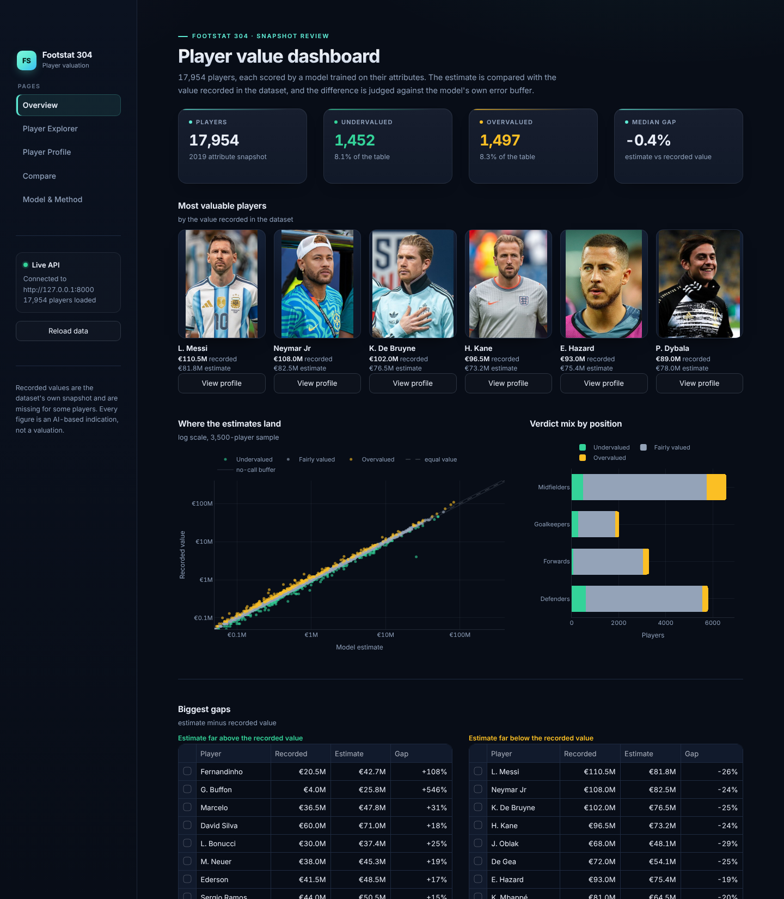
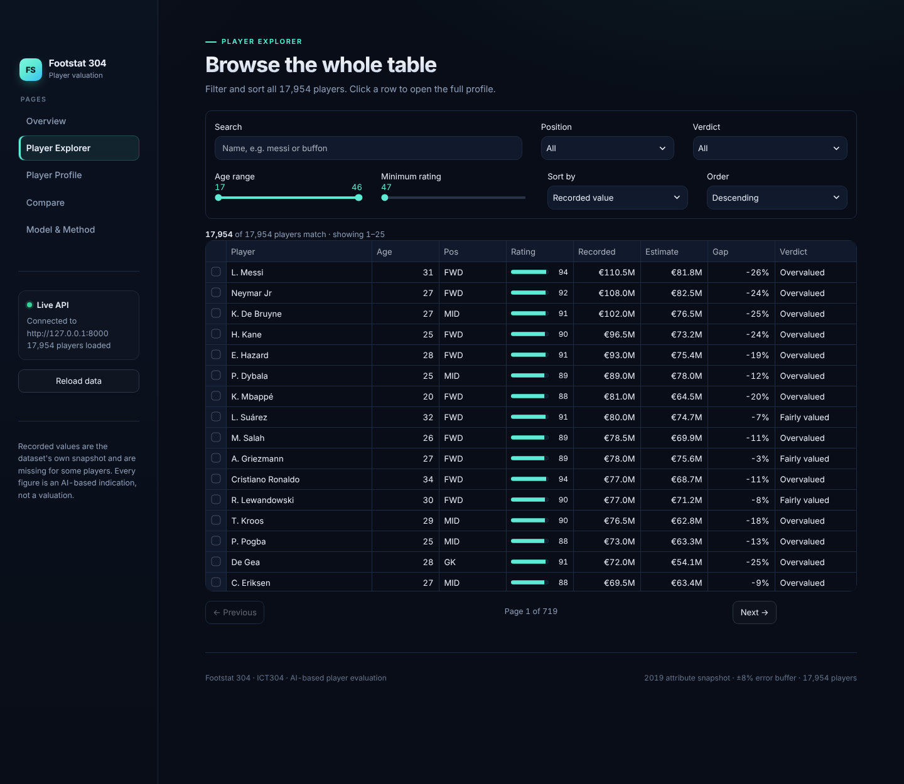
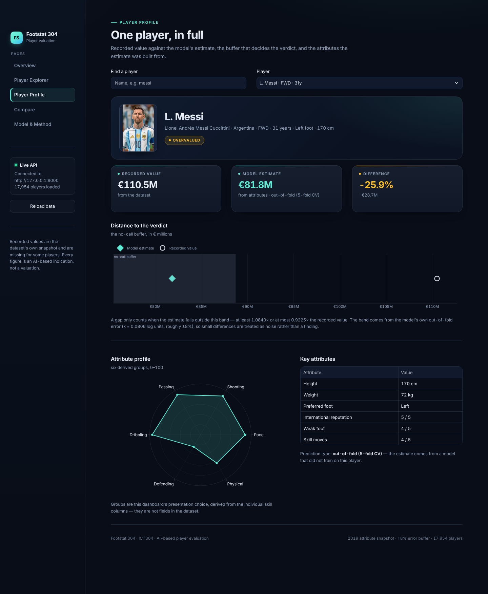
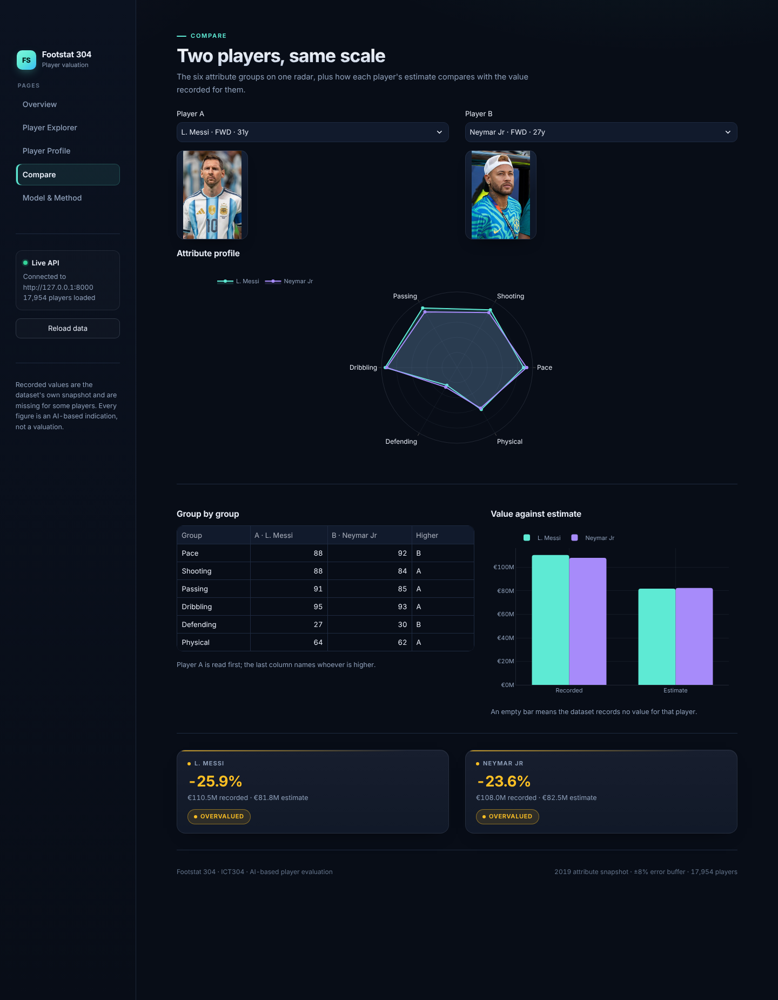
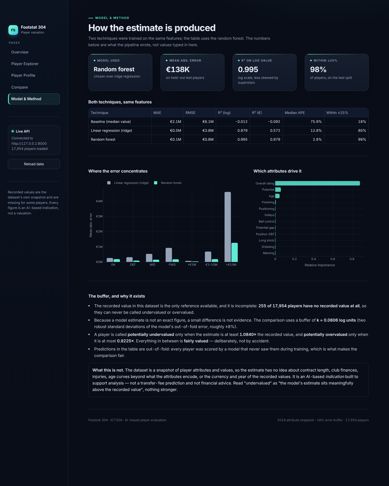
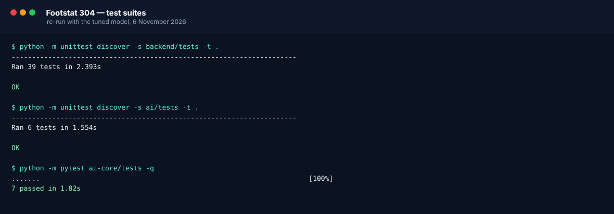
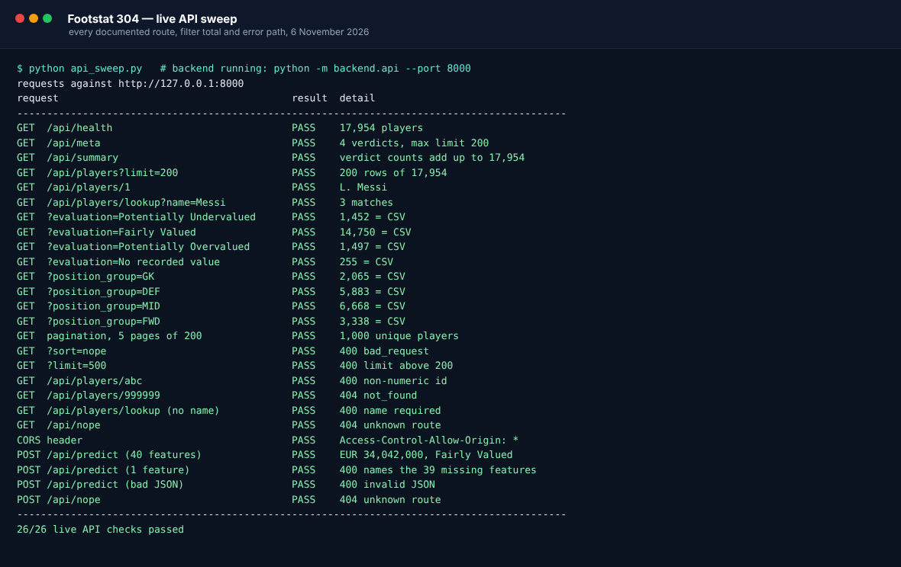
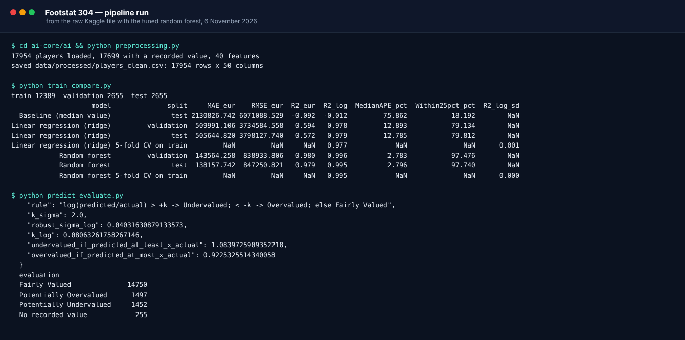

# Verification run and screenshots

> **Note, 6 November 2026.** After this record was written, the random forest was tuned (`max_features` 0.5 → 1.0; see `ai-core/ai/tune_parameters.py` and Section 6.6 of the final report). Numbers below describe the earlier prototype model. Current figures are in `ai-core/outputs/` and in the final report.

This page records what was actually run, on which date, and what it returned. Every
number here came out of a command in this repository — none of it is estimated or
copied from an earlier draft. Screenshots are captures of the running dashboard and
of the real terminal output.

Captured on 5 November 2026.

## 1. The dashboard

Five pages, dark editorial theme, live from the backend API on port 8000.

### Overview

The four verdict counts, the six most valuable players with their photographs, the
estimate-against-recorded scatter with the no-call buffer drawn on it, the verdict mix
by position, and the two biggest-gap tables.

### Player Explorer

Search, position, verdict, age and rating filters over all 17,954 players, sortable by
any column, 25 rows per page, with click-through to a profile.

### Player Profile

The player's photograph and attributes, the recorded value against the model estimate,
the buffer band that decides the verdict drawn to scale, the six-group attribute radar,
and the prediction type.

### Compare

Two players on one radar, group-by-group scores with the higher one named, and their
recorded values beside their estimates.

### Model & Method

Both techniques from `model_comparison.csv`, the error breakdown by group, the twelve
most important features, and the written explanation of the buffer and its limits — read
from `thresholds.json` and the pipeline's own files, not typed in.

## 2. Test suites

| Suite | Command | Result |
| --- | --- | --- |
| Backend | `python -m unittest discover -s backend/tests -t .` | **39 tests, OK** — runs on a bare Python with no dependencies |
| AI runtime | `.venv/Scripts/python -m unittest discover -s ai/tests -t .` | **6 tests, OK** against the real model bundle |
| AI prototype | `.venv/Scripts/python -m pytest ai-core/tests -q` | **7 passed** |

Fifty-two tests in total. On a fresh clone without the 47 MB model bundle the AI runtime
suite now reports **skipped, 0 tests run** instead of a setup error, so a marker never
sees a red failure for a file that was deliberately not committed.

## 3. Live API sweep

Twelve checks against the running server: every documented route, the filter totals
compared with the CSV, and three error paths. All twelve pass, and the backend log
contains no `500` for the whole session.

A longer sweep of the same server (26 checks, including pagination over 1,000 rows, the
`lookup` route, CORS and `POST /api/predict` with a full 40-feature record) also passed
26/26. Filter totals through the API match the prediction table exactly: 15,329 fairly
valued, 1,199 potentially undervalued, 1,171 potentially overvalued, 255 with no
recorded value; GK 2,065, DEF 5,883, MID 6,668, FWD 3,338.

## 4. Pipeline re-run from the raw data

`preprocessing.py` → `train_compare.py` → `predict_evaluate.py`, starting from the
committed raw Kaggle file:

| Output | Result |
| --- | --- |
| `players_clean.csv` | **byte-identical** |
| `player_predictions.csv` | **byte-identical** |
| `thresholds.json` | **byte-identical** — `k_log = 0.09492490316094522`, robust sigma `0.04746245158047261` |
| Label counts | 15,329 / 1,199 / 1,171 / 255 — identical |
| `model_comparison.csv`, `error_breakdown.csv` | differ in the 10th significant digit only (RF test MAE 163,687.360960154**94** vs ...**74**) — floating-point noise between library builds |

The two float-noise CSVs were restored with `git checkout` afterwards, so the tracked
tree is unchanged by the reproduction run.

## 5. Fresh-clone check

`git clone .` into an empty directory and re-run everything, which is what a marker does:

| Check | Result |
| --- | --- |
| Backend suite, bare `python` | 39 tests, OK |
| AI prototype suite | 7 passed |
| AI runtime suite, no bundle | **skipped** (0 run) — the deliberate behaviour after this run |
| Dashboard files | present (`frontend/` is committed) |
| `POST /api/predict` | 503 with a clear message, as documented, until the pipeline is run once |

## 6. Consistency checks done outside the test suites

- **Buffer versus stored verdicts.** Recomputing each player's verdict from the drawn
  band reproduces the stored label for **99.76%** of players. The 43 exceptions are
  boundary rows where the stored prediction is rounded to the nearest €1,000, so the
  ratio lands exactly on 0.9000 or 1.1000; this is the rounding sensitivity already
  recorded in `ai-core/BUFFER_MATH_AND_VALUE_CHECK.md`.
- **Data contract.** `all_players()` returns all 17,954 rows in 4.1 s across 90
  requests, with no column missing against `/api/meta`.
- **Dashboard rendering.** All five pages were exercised headlessly through
  `streamlit.testing.v1.AppTest` twice — once with the API up, once with it stopped —
  with **zero exceptions and zero error boxes**. First load takes about 11 s from the
  API (90 paginated requests, cached for 5 minutes) and 6 s offline; page switches take
  0.4–0.7 s.

## 7. What these images are

- Dashboard images: captured from the running application at a 1306 px page width
  (1440 px viewport), with the backend on `http://127.0.0.1:8000`. Each capture shows the
  top of the page; the sections that continue below the fold are described under each
  image.
- Terminal images: rendered from the captured stdout of the commands in sections 2–4,
  coloured by result. The text is the real output, not a mock-up.

Player photographs are the property of their authors; the source article for each file is
listed in `frontend/assets/players/README.md`.
